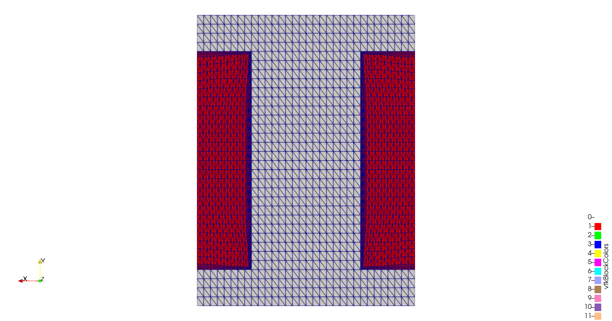
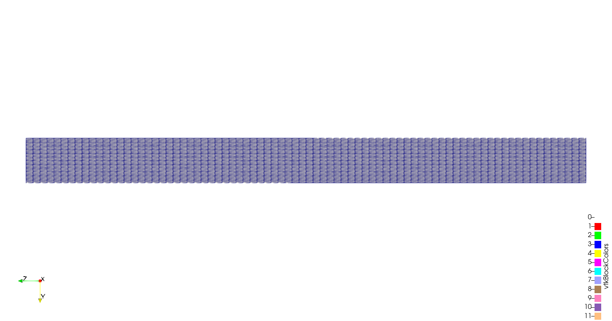

# Simulación térmica de un microcanal

## ¿Qué estamos estudiando?

Este proyecto analiza la transferencia de calor y el cambio de fase agua–vapor dentro de un microcanal. El objetivo es entender cómo un canal de dimensiones micrométricas puede transportar calor de forma eficiente cuando se calienta una base de silicio.

La simulación usa el solver `chtMultiRegionTwoPhaseEulerFoam`, que permite resolver al mismo tiempo. Antes de ejecutar los scripts, carga OpenFOAM:

- El flujo de agua líquida.
- La transferencia de calor entre el fluido y el sólido.
- El transporte de las fases líquida y gaseosa; el cambio de fase está
  actualmente desactivado para esta configuración.
- La caída de presión a lo largo del canal.

## Geometría del canal

El dominio representa una sección de silicio con dos medios canales simétricos. Las dimensiones exteriores son **0.30 × 0.40 × 5 mm** y el diámetro hidráulico del canal completo es **200 µm**.





El modelo se divide en dos regiones:

- `fluid`: canales por donde circulan el agua y el vapor.
- `solid`: estructura de silicio que recibe el calentamiento.

Las regiones se generan automáticamente a partir de la superficie cerrada `geometry/Microcanal.stl`. Esto permite modificar la geometría sin redefinir manualmente todo el dominio fluido.

## Casos con diferentes números de Reynolds

Se han configurado tres casos con la misma geometría general del microcanal,
propiedades físicas, calentamiento, malla y configuración numérica. La
variable de comparación es la velocidad de entrada del agua líquida.

| Caso | Reynolds objetivo | Velocidad de entrada | Caudal másico impuesto |
|---|---:|---:|---:|
| `MicrocanalRe100V1` | 100 | `0.426 m/s` | `2.57 × 10⁻⁵ kg/s` |
| `MicrocanalRe400V1` | 400 | `1.7090763 m/s` | `1.0236 × 10⁻⁴ kg/s` |
| `MicrocanalRe800V1` | 800 | `3.4181527 m/s` | `2.0472 × 10⁻⁴ kg/s` |

El número de Reynolds se calcula con `Re_Dh = ρ U Dh / μ`, usando
`ρ = 997 kg/m³`, `Dh = 200 µm` y `μ = 8.50×10⁻⁴ Pa·s`. Por tanto, los
casos representan flujo laminar con `Re_Dh ≈ 100`, `400` y `800`.

Los valores efectivos de velocidad y caudal se encuentran en
`0/fluid/U.liquid` dentro de cada carpeta.

## Condiciones principales comunes

| Parámetro | Valor |
|---|---:|
| Fluido de entrada | Agua líquida a 300 K |
| Velocidad media de entrada | Depende del caso: `0.426`, `1.7090763` o `3.4181527 m/s` |
| Caudal másico de entrada | Depende del caso: `2.57×10⁻⁵`, `1.0236×10⁻⁴` o `2.0472×10⁻⁴ kg/s` |
| Régimen | Laminar; `Re_Dh ≈ 100`, `400` u `800` |
| Calentamiento de la base | `10⁶ W/m²` |
| Presión de salida | `101325 Pa` |
| Material sólido | Silicio |
| Longitud del dominio | `5 mm` |
| Diámetro hidráulico | `200 µm` |

Las propiedades del agua se interpolan con tablas dependientes de la temperatura
entre 300 y 373.15 K. La velocidad de entrada de cada caso se obtiene mediante:

```text
Re_Dh = ρ U Dh / μ

U = Re_Dh μ / (ρ Dh)
```

El caudal másico se impone en `0/fluid/U.liquid` mediante `flowRateInletVelocity`:

```text
ṁ = ρ U A
```

El campo local `ReDh` se escribe en cada tiempo guardado.

## Parámetros comunes de los tres casos

| Grupo | Parámetros |
|---|---|
| Geometría fluida | Ancho `150 µm`, alto `300 µm`, longitud `5 mm`, `Dh = 200 µm` |
| Sólido | Silicio; dominio exterior `0.30 × 0.50 × 5 mm` |
| Fluido | Agua a `300 K`, `ρ = 997 kg/m³`, `μ = 8.50×10⁻⁴ Pa·s`, `Cp = 4179 J/(kg·K)` |
| Calentamiento | Flujo de calor en la base `10⁶ W/m²` (`100 W/cm²`) |
| Malla base fluida | `50 × 50 × 80 = 200000` celdas, refinada hacia las paredes |
| Malla sólida | Aproximadamente `960000` celdas en la configuración documentada |
| Tiempo | `endTime = 0.1 s`, `deltaT inicial = 10⁻⁸ s`, escritura cada `0.01 s` |
| Paralelización | `4` subdominios |
| Solver | `chtMultiRegionTwoPhaseEulerFoam` |

## Flujo de trabajo

```text
Geometría STL
     ↓
Generación y refinamiento de la malla
     ↓
Separación de regiones sólido–fluido
     ↓
Simulación conjugada multifásica con modelo de cambio de fase configurado
     ↓
Análisis de temperatura, vapor y caída de presión
```

## Cómo ejecutar el caso

Desde la carpeta de cada caso:

```bash
cd MicrocanalRe100V1   # o MicrocanalRe400V1 / MicrocanalRe800V1
bash AllmeshSTL
bash Allrun
```

Para ejecutar en paralelo con cuatro núcleos:

```bash
bash Allrun parallel
```

La prueba rápida de integración puede ejecutarse con:

```bash
python3 scripts/check_euler.py
```

## Resultados que se analizan

El caso registra automáticamente en `postProcessing/`:

- Caída de presión entre la entrada y la salida.
- Temperatura promedio de la base caliente.
- Temperatura promedio de la pared en contacto con el fluido.
- Temperatura media del fluido.
- Distribución de velocidad, presión, temperatura y fracción de vapor.
- Campo local de Reynolds `ReDh` y estadísticas mínimo/medio/máximo mediante
  `scripts/plot_results.py`.

La malla base fluida se configura con **50 × 50 × 80 = 200 000 celdas**,
concentrando la resolución hacia las paredes en x e y. La malla final se
contabiliza en los logs para las regiones `fluid` y `solid`, y ambas deben
pasar la verificación `checkMesh`.

## Archivos principales

- `MicrocanalRe100V1/`, `MicrocanalRe400V1/` y `MicrocanalRe800V1/`: casos con `Re_Dh` aproximado de 100, 400 y 800.
- `geometry/Microcanal.stl`: geometría del microcanal, común a los casos.
- `AllmeshSTL`: generación de la malla multirregión.
- `Allrun`: ejecución de la simulación.
- `system/`: diccionarios de mallado, condiciones y control numérico.
- `scripts/check_euler.py`: prueba de integración.
- `scripts/plot_results.py`: postproceso térmico, hidráulico y Reynolds local.
- `constant/fluid/Tsat_water.csv`: tabla de temperatura de saturación en función
  de la presión.
- `CAMBIOS.md`: documentación técnica completa y registro de configuración.

## Estado actual

Los tres casos están preparados para generar la malla, ejecutar la simulación y
visualizar los resultados en ParaView. La comparación principal debe hacerse
entre la temperatura, la generación de vapor, la caída de presión y el campo
local de Reynolds para `Re_Dh ≈ 100`, `400` y `800`.
